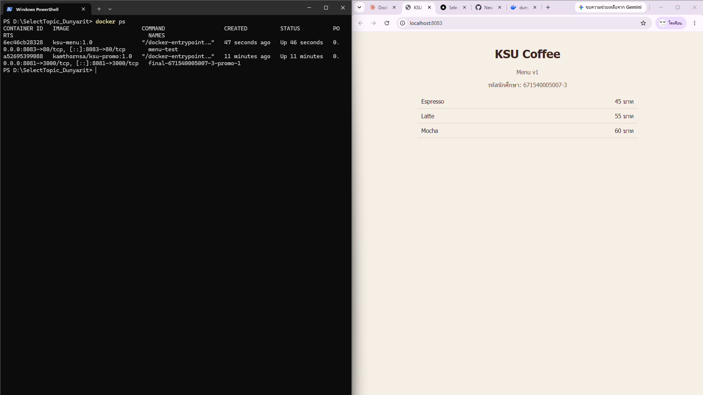
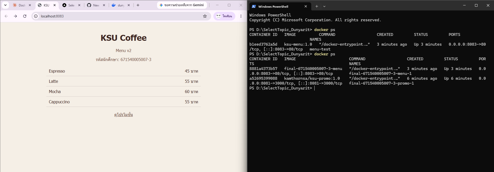
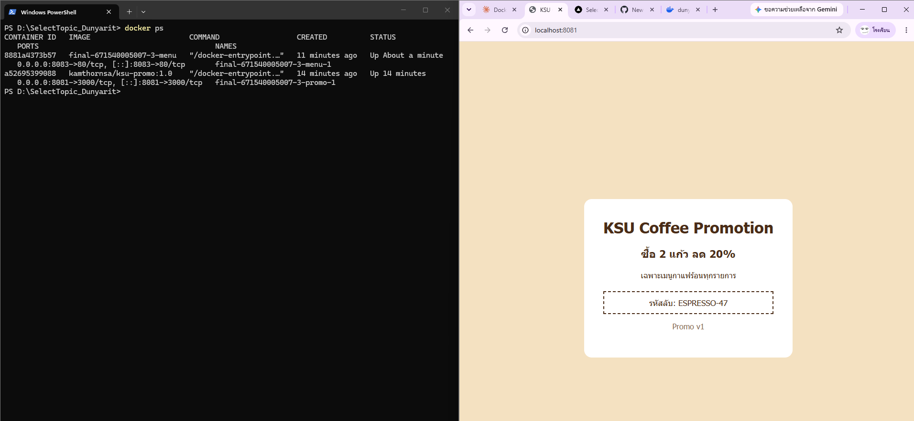

# ANSWER — ดุลยฤทธิ์ บุญเรือน 671540005007-3

> หมายเหตุ: port 8080 บนเครื่องสอบถูก Windows service "AgentService" (PID 5540) ใช้งานอยู่
> จึงใช้ port 8083 แทนสำหรับหน้าเมนู ส่วนหน้าโปรโมชั่นใช้ 8081 ตามโจทย์

## Part A — ข้อมูลจาก image kamthornsa/ksu-promo:1.0

| คำถาม | คำตอบ | คำสั่งที่ใช้ |
| --- | --- | --- |
| Port | 3000/tcp | `docker image inspect kamthornsa/ksu-promo:1.0 --format '{{json .Config.ExposedPorts}}'` |
| CMD | <ผลที่ได้จากคำสั่ง> | `docker image inspect kamthornsa/ksu-promo:1.0 --format '{{json .Config.Cmd}}'` |
| Base image | <ผลที่ได้จากคำสั่ง> | `docker history --no-trunc kamthornsa/ksu-promo:1.0` และ `docker image inspect kamthornsa/ksu-promo:1.0 --format '{{json .Config.Env}}'` |

## Part B — รหัสลับบนหน้าโปรโมชั่น

ESPRESSO-47 (หน้าโปรโมชั่นแสดง Promo v1 จาก image tag 1.0)

## Part C — คำถาม

1. หน้าโปรโมชั่นเป็น image สำเร็จรูปจาก Docker Hub เนื้อหาถูกฝังอยู่ใน layer ของ image และเราไม่มีซอร์สโค้ดมา build ใหม่ ส่วนหน้าเมนู build จาก index.html ของเราเอง แก้ไฟล์แล้ว build ใหม่ได้ทันที
2. <ผลที่เห็นจริงตอนทดลอง เช่น ข้อความ Promo และรหัสลับที่ต่างจาก ESPRESSO-47> เพราะเมื่อไม่ระบุ tag Docker จะใช้ tag `latest` อัตโนมัติ ซึ่งเป็นคนละเวอร์ชันกับ 1.0
3. ฝั่งซ้าย (8081) คือ port บนเครื่องโฮสต์ที่เบราว์เซอร์เข้าถึง ฝั่งขวา (3000) คือ port ที่แอปภายใน container listen อยู่ ไม่ใช่ 80 เพราะ image นี้ไม่ได้ใช้ nginx แต่แอปข้างในเปิด port 3000 ตามที่ตรวจพบใน Part A
4. หน้าเว็บจะไม่เปลี่ยน เพราะ index.html ถูก COPY เข้า image ตอน build แล้ว คำสั่ง `up -d` จะใช้ image เดิมโดยไม่ build ใหม่ คำสั่งที่ถูกคือ `docker compose up -d --build`
5. ใช้ `http://localhost:8081` เพราะลิงก์ถูกเปิดโดยเบราว์เซอร์บนเครื่องโฮสต์ ชื่อ `promo` เป็น DNS ภายใน network ของ Compose ที่ใช้ได้เฉพาะระหว่าง container ด้วยกัน เบราว์เซอร์นอก container จึงไม่รู้จักชื่อนี้

## ภาพหน้าจอ

